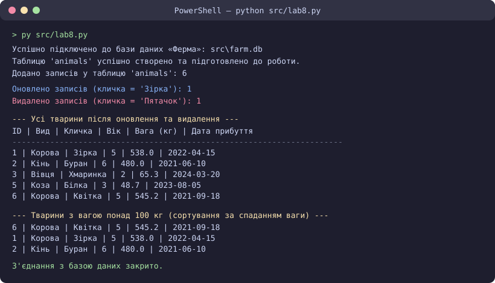
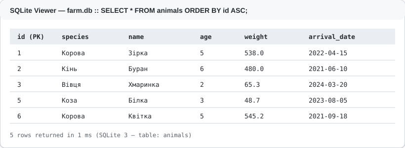

# Звіт до лабораторної роботи № 8

**Тема:** Підключення до бази даних та виконання основних операцій.

**Виконав:** Фесюк Максим Ігорович  
**Група:** КН-25-2  
**Номер варіанту:** 11 (База даних «Ферма», таблиця «Тварини»)

**Мета:** здобути практичні навички роботи з базами даних у мові програмування Python, навчитися виконувати базові операції (створення, вставка, оновлення, видалення, вибірка) та ознайомитися з принципами роботи з SQL.

---

## Хід роботи

### 1. Опис реалізації та результати виконання

Для виконання лабораторної роботи використано реляційну СКБД **SQLite** та стандартну бібліотеку Python **`sqlite3`**. У файлі [`src/lab8.py`](src/lab8.py) реалізовано підключення до бази даних `farm.db` («Ферма») та повний набір CRUD-операцій над таблицею `animals` («Тварини»):

- **Створення таблиці (`CREATE TABLE`):** колонки `id` (`INTEGER PRIMARY KEY AUTOINCREMENT`), `species` (`VARCHAR(100)`), `name` (`VARCHAR(100)`), `age` (`INTEGER`), `weight` (`REAL`), `arrival_date` (`DATE`).
- **Вставка даних (`INSERT INTO`):** додано 6 записів про сільськогосподарських тварин за допомогою параметризованого `executemany()`.
- **Оновлення (`UPDATE`):** оновлено вагу та вік корови за кличкою `'Зірка'`.
- **Видалення (`DELETE`):** видалено запис за кличкою `'Пятачок'`.
- **Вибірка (`SELECT`):** продемонстровано вибірку всіх записів, фільтрацію за вагою (`weight > 100`) із сортуванням `ORDER BY weight DESC` та вибірку за видом `'Корова'` із сортуванням за віком `ORDER BY age ASC`.

#### Результат виконання Python-скрипта в терміналі:



#### Вміст таблиці `animals` у базі даних `farm.db` після виконання операцій:



---

### 2. Контрольне запитання

**Мій варіант:** `11`

**Питання:** `Що таке зовнішній ключ (FOREIGN KEY) в базах даних? Як він забезпечує цілісність даних?`

**Відповідь:**

**Зовнішній ключ (`FOREIGN KEY`)** — це стовпець (або набір стовпців) в одній таблиці (дочірній), значення якого посилаються на первинний ключ (`PRIMARY KEY`) або унікальний ключ (`UNIQUE`) іншої таблиці (батьківської). Він використовується для встановлення логічного зв’язку між таблицями в реляційній базі даних (наприклад, зв'язку «один-до-багатьох» між таблицею «Вольєри» та таблицею «Тварини»).

**Як `FOREIGN KEY` забезпечує посилальну цілісність даних (Referential Integrity):**

1. **Заборона неіснуючих посилань («сирітських» записів):** СУБД не дозволить вставити (`INSERT`) або оновити (`UPDATE`) рядок у дочірній таблиці зі значенням зовнішнього ключа, якого немає у батьківській таблиці.
2. **Контроль видалення та зміни батьківських записів:** за допомогою правил `ON DELETE` та `ON UPDATE` база даних автоматично підтримує узгодженість даних:
   - `RESTRICT` / `NO ACTION` — забороняє видалення запису з батьківської таблиці, якщо на нього посилаються рядки дочірньої таблиці.
   - `CASCADE` — автоматично видаляє (або оновлює) пов'язані записи в дочірній таблиці при видаленні (оновленні) батьківського запису.
   - `SET NULL` / `SET DEFAULT` — встановлює значення `NULL` або значення за замовчуванням у зовнішньому ключі дочірньої таблиці після видалення батьківського рядка.

**Приклад SQL:**

```sql
CREATE TABLE barns (
    id INTEGER PRIMARY KEY AUTOINCREMENT,
    title VARCHAR(100) NOT NULL
);

CREATE TABLE animals (
    id INTEGER PRIMARY KEY AUTOINCREMENT,
    name VARCHAR(100) NOT NULL,
    barn_id INTEGER,
    FOREIGN KEY (barn_id) REFERENCES barns(id) ON DELETE SET NULL
);
```

---

## Висновки

Під час виконання лабораторної роботи я здобув практичні навички взаємодії з реляційною базою даних у Python за допомогою модуля `sqlite3`. Я навчився встановлювати та коректно закривати з'єднання з БД, проєктувати структуру таблиці з первинним ключем і різними типами даних (`INTEGER`, `VARCHAR`, `REAL`, `DATE`), виконувати параметризовані SQL-запити (`CREATE TABLE`, `INSERT`, `UPDATE`, `DELETE`, `SELECT` із `WHERE` та `ORDER BY`), які захищають програму від SQL-ін'єкцій, а також перевіряти роботу з БД за допомогою юніт-тестів в оперативній пам'яті (`:memory:`).
